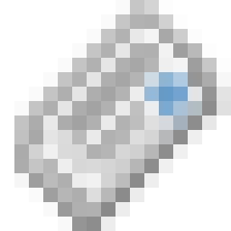

# ACME Journal (content management)

ACME Inc.'s journal as a desktop program: posts, search, related posts and a read-only JSON API, shown
in its own window. ACME Inc. and everyone in it is fictional; post text is lorem ipsum.

- **Posts** are the CMS's own content, embedded in the exe from `mock/posts.json` (60 posts).
- **Authors** come from the shared ACME database's `employees` table, opened **read-only by path**. The
  path is `-db PATH`, the `ACME_DB` environment variable, the one saved on the **About** page, or
  `%LOCALAPPDATA%\ACME Inc\acme.db`. With no usable database the authors come from the embedded
  `mock/employees.json`, and the footer says so. `-mock` forces the snapshot.

The window is Microsoft Edge WebView2 (part of Windows 10/11). The pages are served by the exe itself on
`127.0.0.1`, to that window only: the first request carries a per-run token that becomes an HttpOnly,
SameSite=Strict cookie, and every other request without it, or with another `Host`, is refused.

## Build and run

```bash
go build -ldflags "-H windowsgui" -o acme-cms.exe .
```

```bash
acme-cms.exe
```

`go run . -serve` serves the same pages without a window on `http://127.0.0.1:8720/` (`-addr` changes
it), for development. `rsrc_windows_amd64.syso` embeds the pixel icon and a DPI-aware manifest; it is
generated from `icon/app.res` by the portfolio's `tools/pixel_icons.py --syso`.

## Install

```bash
acme-cms.exe -install
```

Installs for the current user (no admin rights): copies the exe to
`%LOCALAPPDATA%\Programs\ACME Inc\ACME Journal\`, adds **ACME Inc → ACME Journal** to the Start menu
(`-desktop-shortcut` for the desktop too) and lists it in **Apps & features**. `acme-cms.exe -uninstall`
(or Apps & features) removes it again; the database is never deleted (`-purge` also removes the CMS's
own settings and WebView2 profile). `-root DIR` does it all inside DIR instead. Other flags: `-version`,
`-quiet`, `-smoke FILE`.

| Path | What |
|---|---|
| `GET /` | Published posts, newest first; `?q=` searches |
| `GET /posts/{slug}` | One post with three related posts; a bad slug gets a did-you-mean |
| `GET /about` | Version, icon credit, and the shared database path (`POST` to change it) |
| `GET /api/posts` | Published posts (title, slug, author, date, excerpt) |
| `GET /api/posts/{slug}` | One post; `404` with `did_you_mean` for a near miss |
| `GET /api/posts/{slug}/related` | TF-IDF related posts (`internal/related`) |
| `GET /api/search?q=` | Posts containing every word |
| `GET /api/source` | Where authors came from, counts and version |
| `GET /api/health` | Runtime health (`internal/health`) |

Writing posts and moving them into the shared database are not built yet. The earlier SQLite design is
kept in `reference/sqlite_server.go.txt`.

## Dependencies

- `github.com/jchv/go-webview2`: the native window. It drives WebView2 from pure Go, so no C compiler
  (cgo) is needed.
- `modernc.org/sqlite` (pinned at v1.46.1, the last release for Go 1.24): reads the shared SQLite file,
  also without cgo.

## Tests

```bash
go vet ./...
```

```bash
go test ./...
```

`go test -short ./...` skips the one test that runs PowerShell to make a real shortcut in a temp folder.

## Icon and license

Icon: Silk "newspaper" by Mark James, CC BY 2.5, enlarged by nearest-neighbour (`icon/README.md`).
Code: AGPL-3.0, as the rest of the portfolio.
